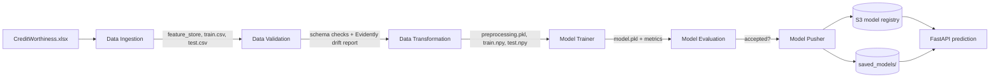

# Credit Worthiness Prediction — Production Ready MLOps Project

An end to end machine learning project that predicts whether a loan applicant has a **good** or a
**bad** credit score. It covers the whole life cycle: data ingestion from the source workbook, data
validation with drift detection, data transformation, model training with a grid search, model
evaluation against the model currently in production, model deployment to an S3 registry, a FastAPI
web interface for interactive predictions and a GitHub Actions workflow that ships the Docker image
to Amazon ECR and runs it on an EC2 instance.

---

## Problem statement

A bank has to decide, for every application it receives, whether the money is likely to come back.
The decision is traditionally taken by a credit officer who reads the application form: how much is
requested, for how long, what the applicant owns, how stable the employment is and how the previous
credits were repaid.

This project turns that decision into a classification model, so that the clear cases are handled
automatically and the credit officers can focus on the borderline ones.

## The dataset

`data/CreditWorthiness.xlsx`, sheet `Data`: **1000 applications, 21 columns**, no missing values and
no duplicates. The target column is `credit_score`, with 70% `good` and 30% `bad`.

The workbook ships abbreviated column names, which the ingestion step renames to descriptive ones
using `raw_column_mapping` in `config/schema.yaml`:

| Workbook | Project | Meaning |
| --- | --- | --- |
| `Cbal` | `checking_balance` | balance of the current account |
| `Cdur` | `credit_duration` | duration of the requested credit, in months |
| `Chist` | `credit_history` | how the previous credits were repaid |
| `Cpur` | `credit_purpose` | what the money is needed for |
| `Camt` | `credit_amount` | amount of the requested credit |
| `Sbal` | `savings_balance` | balance of the savings account |
| `Edur` | `employment_duration` | how long the applicant has held the current job |
| `InRate` | `installment_rate` | installment as a percentage of the disposable income |
| `MSG` | `marital_status_gender` | marital status combined with gender |
| `Oparties` | `other_parties` | co-applicants or guarantors |
| `Rdur` | `residence_duration` | how long the applicant has lived at the present address |
| `Prop` | `property_type` | most valuable property owned |
| `age` | `age` | age of the applicant |
| `inPlans` | `installment_plans` | other installment plans running |
| `Htype` | `housing_type` | owned, rented or free housing |
| `NumCred` | `existing_credits` | number of credits already held at this bank |
| `JobType` | `job_type` | qualification of the applicant |
| `Ndepend` | `num_dependents` | number of financially dependent people |
| `telephone` | `telephone` | whether a telephone is registered (dropped, see below) |
| `foreign` | `foreign_worker` | whether the applicant is a foreign worker |
| `creditScore` | `credit_score` | **target**, good or bad |

**Feature engineering.** `monthly_installment = credit_amount / credit_duration` is derived, because
the amount and the duration are correlated and their ratio is what a credit officer actually looks
at. `telephone` is dropped: the chi-squared test shows it is independent of the target.

## Pipeline architecture



| Stage | What it does |
| --- | --- |
| **Data Ingestion** | Reads the workbook, renames and normalises the columns, writes the feature store and a stratified train/test split. |
| **Data Validation** | Checks the number of columns, the presence of every expected column and the absence of missing values, then produces an Evidently drift report (`report.yaml` and `report.html`). |
| **Data Transformation** | Adds `monthly_installment`, drops the useless columns, one-hot encodes the nominal columns, ordinal encodes the ordered ones, applies a Yeo-Johnson power transform to the skewed ones, standardises the numerical ones and balances the **training** set with SMOTE. |
| **Model Trainer** | Runs a grid search over the models declared in `config/model.yaml` and keeps the best one, wrapped together with the preprocessor into a single artifact. |
| **Model Evaluation** | Scores the fresh model against the model currently in production and accepts it only if the F1 improves by more than the configured threshold. |
| **Model Pusher** | Copies the accepted model into the local registry (`saved_models/`) and uploads it to the S3 registry when AWS is configured. |

## Project structure

```
.
├── app.py                      FastAPI application: HTML form, JSON API, /train endpoint
├── demo.py                     Runs the whole training pipeline from the command line
├── template.py                 Recreates the empty project skeleton
├── Dockerfile                  Image used by the CI/CD workflow
├── config
│   ├── schema.yaml             Column mapping, column roles, encoders, ordinal orders
│   ├── model.yaml              Models and grids explored by the model trainer
│   └── form.yaml               Fields rendered by the web interface
├── data
│   └── CreditWorthiness.xlsx   Source dataset
├── notebook
│   ├── 1_EDA_Credit_Worthiness.ipynb
│   └── 2_Feature_Engineering_and_Model_Training.ipynb
├── credit_worthiness
│   ├── components/             The six pipeline stages
│   ├── configuration/          AWS connection
│   ├── cloud_storage/          S3 helper
│   ├── constants/              Every constant of the project
│   ├── data_access/            Reads and cleans the source workbook
│   ├── entity/                 Config, artifact and estimator dataclasses
│   ├── exception/, logger/     Cross cutting concerns
│   ├── pipeline/               Training pipeline and prediction pipeline
│   └── utils/                  Serialization, feature and input validation helpers
├── scripts/ensure_model.py     Publishes a model to the S3 registry before a deployment
├── tests/test_app.py           Smoke tests for the serving layer
├── static/css/style.css
└── templates/creditworthiness.html
```

## Getting started

```bash
python -m venv venv
venv\Scripts\activate          # Linux/macOS: source venv/bin/activate

pip install -r requirements.txt        # runtime + pipeline
pip install -r requirements-dev.txt     # add this to run the notebooks and the tests
```

Use Python 3.12, the version the container runs: the serving container unpickles the estimator, and
a `scikit-learn` that differs from the one that wrote the model silently loads it and can return
different predictions. The pins are part of the contract rather than housekeeping.

`requirements.txt` pins the direct dependencies and `requirements.lock` pins the transitive ones, so
two builds of the same commit install the same graph. Regenerate the lock after every change to
`requirements.txt`:

```bash
docker build -t creditworthiness:latest .
docker run --rm creditworthiness:latest pip freeze --exclude-editable > requirements.lock
```

### Run the tests

```bash
pytest tests -v
```

The tests that need a trained model are skipped when no registry holds one, so the suite also runs
on a fresh checkout.

### Train the model

```bash
python demo.py
```

The run writes a timestamped folder under `artifact/`, a log file under `logs/` and, when the model
is accepted, `saved_models/model.pkl`.

### Serve the predictions

```bash
python app.py
```

| Route | Method | Description |
| --- | --- | --- |
| `/` | GET | HTML form with every application field |
| `/` | POST | Prediction rendered back into the form page |
| `/predict` | POST | Same prediction as JSON |
| `/train` | POST | Triggers the training pipeline, requires the `X-Train-Token` header |
| `/health` | GET | Liveness probe: the process answers |
| `/ready` | GET | Readiness probe used by the Docker healthcheck: a model is loaded |
| `/docs` | GET | Interactive OpenAPI documentation |

Example of a JSON call:

```bash
curl -X POST http://localhost:8080/predict -H "Content-Type: application/json" -d '{
  "checking_balance": "no checking account", "credit_duration": 12, "credit_amount": 25000,
  "credit_history": "none taken/all settled", "credit_purpose": "new vehicle",
  "savings_balance": "Rs. >= 10,000", "employment_duration": "more than 7 years",
  "installment_rate": 2, "marital_status_gender": "single male", "other_parties": "no one",
  "residence_duration": "more than 3 years", "property_type": "real estate", "age": 45,
  "installment_plans": "none", "housing_type": "own", "existing_credits": 1,
  "job_type": "employee with official position", "num_dependents": 1, "foreign_worker": "no"
}'
```

```json
{"status": true, "credit_score": "good", "is_creditworthy": true,
 "context": "Creditworthy - credit can be granted", "risk_probability": 12.0}
```

## Docker

```bash
docker build -t creditworthiness:latest .

# The image carries no model: saved_models/ is git ignored and excluded from the build
# context, so a local image is identical to the one built by CI. Mount the local registry
# to serve the model trained on this machine.
docker run -p 8080:8080 -v "$(pwd)/saved_models":/app/saved_models creditworthiness:latest
```

The healthcheck probes `/ready`, so a container without a model is reported as `unhealthy` instead
of accepting traffic it cannot serve. To bootstrap a model inside an empty container:

```bash
docker run -d -p 8080:8080 -e TRAIN_API_TOKEN=choose-a-token creditworthiness:latest
curl -X POST http://localhost:8080/train -H "X-Train-Token: choose-a-token"
```

With the S3 model registry:

```bash
docker run -p 8080:8080 \
  -e AWS_ACCESS_KEY_ID=... -e AWS_SECRET_ACCESS_KEY=... -e AWS_DEFAULT_REGION=us-east-1 \
  creditworthiness:latest
```

Without AWS credentials the application falls back to the model mounted at `/app/saved_models`, so
the container is fully usable on a laptop.

### Environment variables

| Variable | Effect |
| --- | --- |
| `AWS_ACCESS_KEY_ID`, `AWS_SECRET_ACCESS_KEY`, `AWS_DEFAULT_REGION` | Enable the S3 model registry |
| `TRAIN_API_TOKEN` | Enables `POST /train`; the endpoint answers `403` while it is unset |
| `CORS_ALLOW_ORIGINS` | Comma separated origins, `*` by default (credentials are then disabled) |

## Deployment on AWS

1. **IAM user** with `AmazonEC2ContainerRegistryFullAccess`, `AmazonEC2FullAccess` and
   `AmazonS3FullAccess`; keep the access key and the secret.
2. **S3 bucket** named as `MODEL_BUCKET_NAME` in `credit_worthiness/constants/__init__.py`
   (`creditworthiness-model-registry` by default). This is the model registry the pusher writes to
   and the prediction pipeline reads from.
3. **ECR repository**, for example `creditworthiness`; copy its URI.
4. **EC2 instance** (Ubuntu, port 8080 open in the security group) with Docker installed:
   ```bash
   sudo apt-get update -y && sudo apt-get upgrade -y
   curl -fsSL https://get.docker.com -o get-docker.sh && sudo sh get-docker.sh
   sudo usermod -aG docker ubuntu && newgrp docker
   ```
5. **Self hosted runner**: on GitHub, *Settings → Actions → Runners → New self-hosted runner*, then
   run the printed commands on the EC2 instance.
6. **Repository secrets** (*Settings → Secrets and variables → Actions*):

   | Secret | Example |
   | --- | --- |
   | `AWS_ACCESS_KEY_ID` | `AKIA...` |
   | `AWS_SECRET_ACCESS_KEY` | `wJal...` |
   | `AWS_DEFAULT_REGION` | `us-east-1` |
   | `ECR_REPO` | `creditworthiness` |
   | `TRAIN_API_TOKEN` | any long random string, optional |

Pushing to `main` runs the tests, makes sure the S3 registry holds a model, builds the image, pushes
it to ECR and restarts the container on the EC2 instance. The deployment job then waits for the
readiness probe, so a release that cannot serve predictions shows up as a red run instead of a green
one. The application is available at `http://<ec2-public-ip>:8080`.

`workflow_dispatch` takes a `retrain` input that forces a fresh training run and republishes the
model to the registry.

The image never contains a model. The pipeline publishes it to `s3://<MODEL_BUCKET_NAME>/model.pkl`,
and the EC2 container also mounts `/opt/creditworthiness/saved_models`, so a model trained through
`/train` survives the next deployment.

## Configuration reference

* **`config/schema.yaml`** — the column mapping, the numerical and categorical columns validated by
  the pipeline, the columns to drop, and which columns go through the one-hot encoder, the ordinal
  encoder (with their explicit order), the power transformer and the standard scaler.
* **`config/model.yaml`** — the grid search settings and the candidate models. Add a model by adding
  a `module_n` entry with its class, module, default params and grid.
* **`config/form.yaml`** — the fields rendered by the HTML form. The application reads it at start
  up, so adding a field to the form does not require touching the template.
* **`credit_worthiness/constants/__init__.py`** — paths, split ratio, the expected minimum score,
  the acceptance threshold, the bucket name and the host/port of the application.

## Results

Measured on a test set that is never resampled, so the numbers describe the real population of
applicants:

| Metric | Value |
| --- | --- |
| Accuracy | ≈ 0.77 |
| F1 (bad credit score) | ≈ 0.56 |
| Precision (bad credit score) | ≈ 0.67 |
| Recall (bad credit score) | ≈ 0.48 |

The second notebook compares no resampling, SMOTE and SMOTEENN over nine classifiers and shows why
the pipeline settled on SMOTE.

## License

See [LICENSE](LICENSE).
